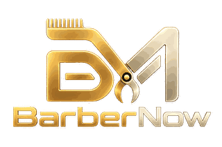

# BarberNow



BarberNow reúne una landing pública, un portal para propietarios de barberías, profesionales independientes y clientes. La interfaz usa el logo autorizado y un favicon derivado de la misma imagen PNG transparente, sin marcos, recuadros ni fondos añadidos.

## Inicio local

Desde la raíz del repositorio:

```powershell
npm ci
npm run dev
```

La aplicación sirve la landing y el acceso en el mismo origen. Para usar datos reales se requieren las variables de entorno de Supabase y `VITE_BACKEND_MODE=live`; no se deben publicar claves privadas en el frontend.

## Componentes

- `landing/`: página pública, directorio y profesionales.
- `src/`: React, rutas de autenticación y portales de trabajo.
- `backend/`: API y seguridad multiinquilino.
- `public/branding/barbernow-logo.png`: logo oficial transparente del sistema.
- `landing/public/branding/barbernow-logo.png`: mismo logo para el despliegue independiente de la landing.

## Validación

```powershell
npx tsc --noEmit
npm run build
```

La vinculación por QR, las rutas técnicas existentes, los servicios de Docker y las tablas de Supabase conservan sus identificadores para no romper la compatibilidad.
